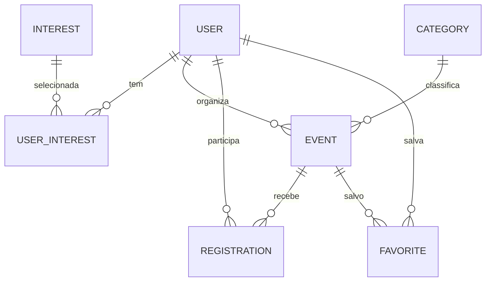

# Banco PostgreSQL — modelo relacional proposto

**Documento de referência** para orientar o colega, **não é um banco criado**. Use migrations e Hibernate/JPA no backend. A ideia está normalizada (entidades separadas e tabelas de associação N:N).

## Tabelas sugeridas

| Tabela | Campos principais | Regras |
|---|---|---|
| `users` | `id`, `name`, `email`, `password_hash`, `role`, `age`, `city`, `state`, `avatar_url`, `latitude`, `longitude`, `created_at` | `email` UNIQUE, role USER/ORGANIZER; senha somente hash |
| `interests` | `id`, `name` | catálogo de temas; IDs estáveis como `musica`, `arte` |
| `user_interests` | `user_id`, `interest_id` | PK composta, ambas FKs |
| `categories` | `id`, `name` | categorias por evento |
| `events` | `id`, `organizer_id`, `category_id`, `title`, `description`, `starts_at`, `address`, `neighborhood`, `city`, `state`, `latitude`, `longitude`, `capacity`, `price`, `image`, `status` | `organizer_id` FK users, `capacity > 0`, `price >= 0` |
| `registrations` | `id`, `user_id`, `event_id`, `status`, `created_at` | UNIQUE (`user_id`, `event_id`) |
| `favorites` | `user_id`, `event_id`, `created_at` | PK composta |

**Campos derivados:** `registeredCount` no JSON vem de COUNT das inscrições ativas (ou de contador atualizado com transação), não precisa ser coluna duplicada que cause inconsistência. `organizerName` vem do relacionamento com `users`.

## Atenção na normalização

- Não armazenar interesses concatenados em `users` (usar `user_interests`).
- Não guardar várias inscrições em uma coluna de `events` (usar `registrations`).
- Não duplicar nome/e-mail de organizador no evento; usar relacionamento.
- Bloquear inscrição duplicada por constraint e concorrência pelo Service/DB.
- Senhas e chaves são sempre de responsabilidade do backend.

## Localização e privacidade

`city` é suficiente para o uso sem permissão. `latitude`/`longitude` são opcionais e só devem ser armazenadas com finalidade definida e quando autorizadas. O MVP não precisa de rastreamento contínuo.
