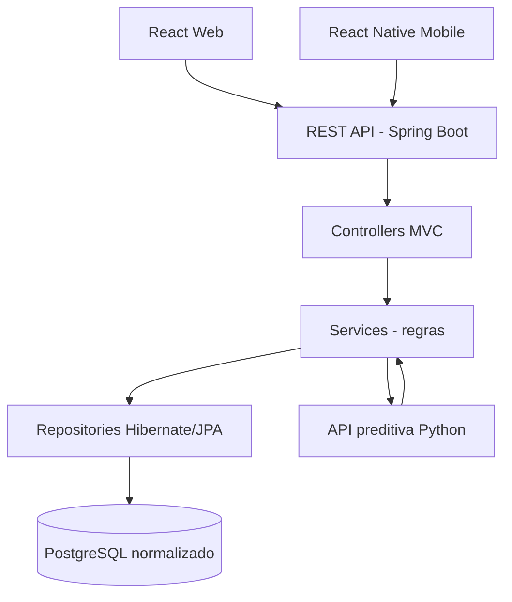

# Arquitetura — ElderConnect

## Padrões escolhidos

- **Backend: MVC (Model-View-Controller) com camadas Controller → Service → Repository.** Controladores HTTP recebem/validam requests, Services coordenam regras, Repositories (JPA/Hibernate) acessam entidades do banco PostgreSQL. Spring Boot é responsável por autenticação, autorização e consistência de transações.
- **Frontend React: componentização + organização por módulo + adaptadores de acesso a dados.** `pages` são as views, `app/AppContext` gerencia estado da sessão, `domain` concentra funções puras, `services/httpApi` executa as chamadas REST. `demoStore` substitui `httpApi` SOMENTE para demonstração.
- **Mobile React Native: telas e componentes + contexto + adaptadores.** A navegação usa React Navigation (Stack + Bottom Tabs), amplamente utilizado. O serviço HTTP segue o mesmo contrato do Web.
- **IA: serviço Python separado** com um endpoint preditivo de classificação/regressão. O Spring Boot consulta esse serviço e faz a composição dos dados de eventos para as interfaces. A IA não acessa diretamente o banco pelo frontend.

## Por que não usar MVC à força dentro do React?

O edital exige **código estruturado no padrão MVC** (item 6.4). A interpretação convencional para Spring Boot é a camada MVC no servidor; React é uma biblioteca de interfaces orientada a componentes. Documentar essa separação evita um antipadrão em que cada componente executa consulta SQL ou cálculo de recomendação diretamente. A aderência deve ser validada com o professor.

## Responsabilidades

- `src/pages` e `src/screens`: apresentação e interação com o usuário, sem SQL ou chamadas diretas para Python.
- `src/domain`: utilitários puros de validação, datas, distâncias e ordenação da simulação.
- `src/services/httpApi`: um único ponto de acesso à API Spring Boot; centralizar headers, timeout, erros e autenticação.
- `src/services/demoStore`: persistência LOCAL e dados fictícios; nenhum resultado tem validade fora do navegador/dispositivo.
- `AppContext`: fornece dados e ações comuns às telas, evita passagem excessiva de propriedades.
- Banco: normalização, constraints, chaves estrangeiras, transações e controle de concorrência para inscrições.
- ML: treinamento, avaliação, versionamento do modelo e inferência no backend (sem treinar no frontend).

## Segurança e privacidade antes de produção

1. **Não confiar em `role` enviado pelo frontend.** O Spring Boot deve autorizar `ORGANIZER` em POST `/events` e `USER` nas inscrições; não confiar em `organizerId` informado pelo cliente.
2. **Senha**: o servidor aplica hash resistente com salt, como BCrypt/Argon2, e nunca retorna `passwordHash`.
3. **Tokens**: HTTPS, expiração e estratégia segura de armazenamento. Não usar `localStorage`/`AsyncStorage` como solução definitiva para tokens sensíveis.
4. **Fotos**: validar MIME/limite de tamanho, armazenar com permissões apropriadas, URL segura e exclusão quando solicitada.
5. **Localização**: obter consentimento explícito; evitar reter coordenadas precisas sem necessidade. Cidade informada é fallback.
6. **Capacidade de eventos**: proteger inscrições concorrentes em transação no backend; não confiar na contagem do frontend.
7. **LGPD**: definir aviso de privacidade, finalidade, consentimento quando aplicável e política de exclusão de dados, antes de registrar usuários reais.

## Fonte oficial de interfaces

`docs/CONTRATO_API.md` descreve endpoints e exemplos. Em caso de alteração, coordenar a mesma PR para Web, Mobile e Spring Boot.
